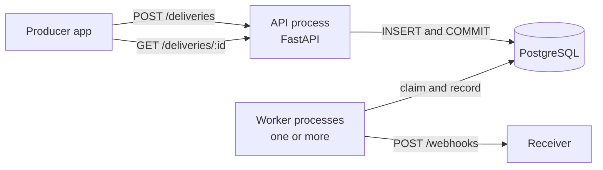
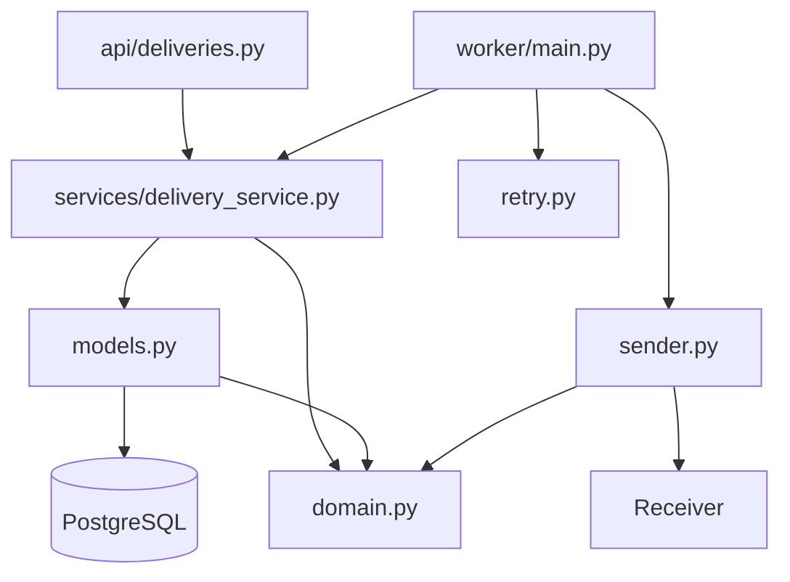
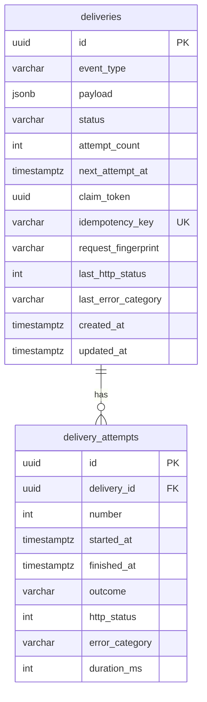
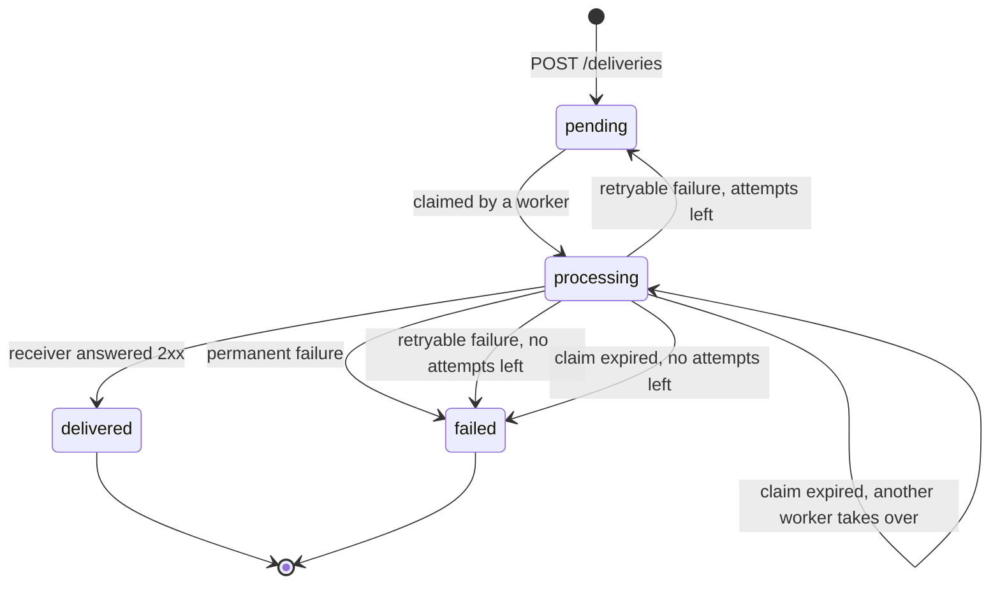
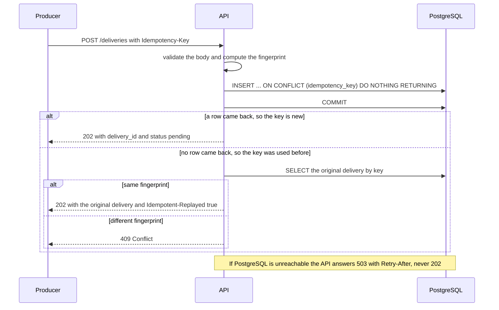
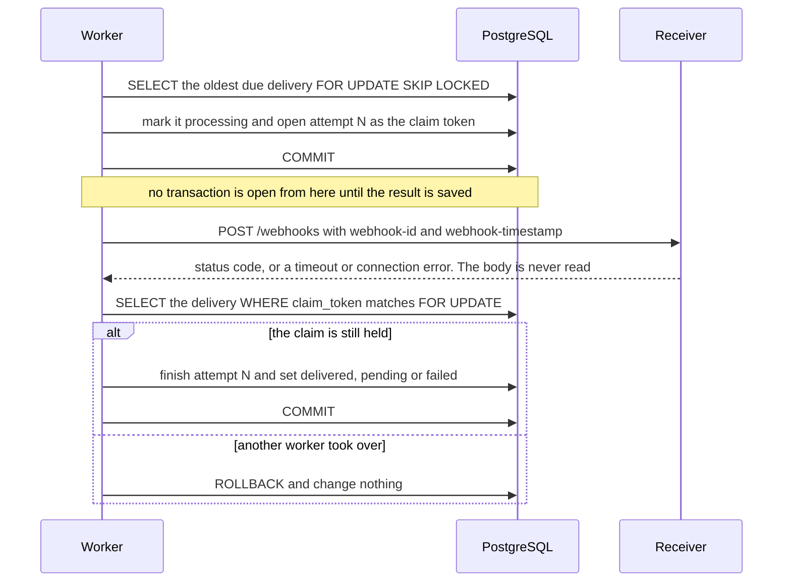
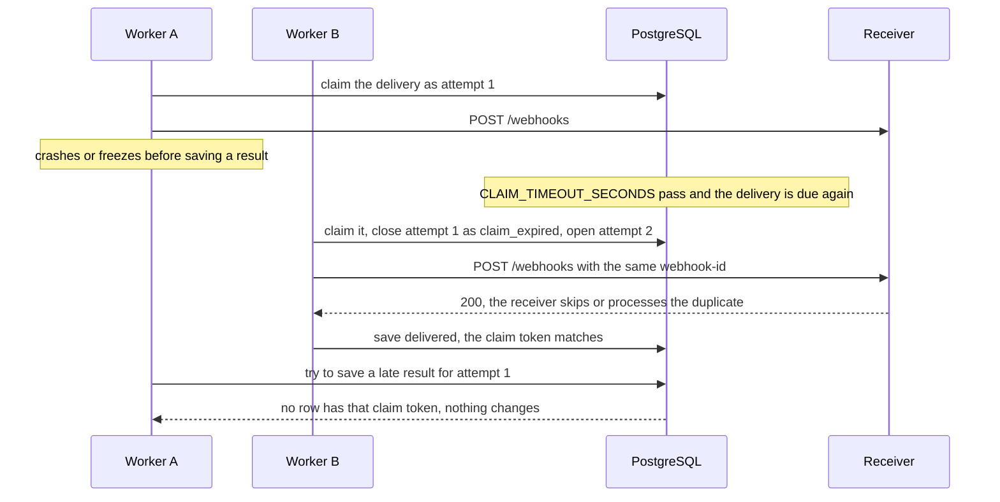

# Architecture

This document explains how the webhook delivery service is built and why. To run and use it, see
the [user manual](docs/USER_MANUAL.md). To see how the design grew one guarantee at a time, see
[how it was built](docs/MILESTONES.md).

## Contents

- [Goals and non-goals](#goals-and-non-goals)
- [System overview](#system-overview)
- [Components](#components)
- [Code structure](#code-structure)
- [Data model](#data-model)
- [Delivery state machine](#delivery-state-machine)
- [Flows](#flows)
- [Concurrency control](#concurrency-control)
- [Retry policy](#retry-policy)
- [Guarantees and failure modes](#guarantees-and-failure-modes)
- [Design decisions](#design-decisions)
- [Testing strategy](#testing-strategy)
- [Limitations and future work](#limitations-and-future-work)

## Goals and non-goals

**Goals**

- Accept events from producer applications and deliver them to a receiver over HTTP.
- State every guarantee explicitly and test it: what is stored, what can repeat, and what happens
  when a process dies at any moment.
- Keep the moving parts few: one codebase, one PostgreSQL database, two kinds of process.

**Non-goals for now**

- Destinations chosen by producers (a server-side request forgery risk), multiple tenants,
  ordering guarantees and a dashboard.
- Message brokers such as Kafka, RabbitMQ or Redis, and Kubernetes. PostgreSQL is enough at this
  scale, and one system is easier to reason about.

## System overview



The API and the workers never call each other. The database is their only connection: the API
writes deliveries, and the workers claim, send and update them. That is why each side can stop,
restart or scale on its own. Both depend on PostgreSQL, which is the one shared point of failure.

## Components

| Component | Owns | Does not own |
|---|---|---|
| API: `main.py`, `api/deliveries.py` | Request validation, idempotent submission, reading deliveries, mapping errors to `409`, `422` and `503` | Sending webhooks |
| Service layer: `services/delivery_service.py` | Every transaction: create, read, claim and record | HTTP on either side |
| Worker: `worker/main.py` | The loop (claim, send, record, wait), logging, clean stop on `SIGINT`/`SIGTERM`, carrying on through database outages and unexpected errors | Deciding what an attempt means: `sender.py` classifies it, `retry.py` sets the delay, and the service layer applies the attempt limit |
| Sender: `sender.py` | One HTTP attempt, classified by the status code alone; the response body is never read | Database state |
| Retry policy: `retry.py` | The delay before the next attempt | Whether to retry at all, which depends on the outcome and the attempt limit |
| Domain: `domain.py` | The shared vocabulary: delivery states, attempt outcomes, error categories and the attempt result | Any behavior; it imports nothing else from the service |
| PostgreSQL | Durable state, the queue, uniqueness, row locks, invariants enforced by constraints | Talking to receivers |
| Receiver (external) | Processing events and skipping duplicates by `webhook-id` | Retrying, which the service does |

## Code structure



`domain.py` sits underneath everything: the database models, the sender and the service layer all
use its states and outcomes, and it uses none of them. In particular, the database models do not
depend on the HTTP sender.

Four rules keep the layers honest:

1. **The service layer owns the transactions.** HTTP handlers and the worker loop contain no SQL
   and never commit; each service function commits its own work before it returns.
2. **No network call happens inside a database transaction.** The worker commits its claim before
   sending and opens a new transaction to record the result, so a slow receiver can never hold
   database locks.
3. **Code is synchronous.** SQLAlchemy and HTTPX2 are used in their blocking forms, and the API
   endpoints are plain `def` functions, which FastAPI runs in a thread pool. Throughput comes from
   running more workers, not from concurrency inside one.
4. **Answers from the receiver are untrusted input.** The sender reads only the status code and
   turns every kind of request failure into a classified result, and the worker loop survives
   any unexpected error. No answer can exhaust a worker's memory, hold it up or stop it.

## Data model



### `deliveries`

One row per accepted event. The row is both the delivery's record and its queue entry, so the two
can never disagree.

| Column | Meaning |
|---|---|
| `id` | Delivery ID. Sent as `webhook-id` on every attempt. |
| `event_type` | For example `booking.confirmed`. |
| `payload` | The producer's `data` object, stored as JSONB. Key order and whitespace are not kept. |
| `status` | `pending`, `processing`, `delivered` or `failed`. |
| `attempt_count` | Attempts claimed so far, including any cut short before the request was sent. |
| `next_attempt_at` | While `pending`: when the delivery is due. While `processing`: when the current claim expires. Not meaningful once `delivered` or `failed`. |
| `claim_token` | ID of the attempt that holds the claim. Set only while `processing`. |
| `idempotency_key` | The producer's `Idempotency-Key`, if it sent one. Unique. |
| `request_fingerprint` | SHA-256 of the request's canonical JSON, to detect a key reused with different content. |
| `last_http_status`, `last_error_category` | Result of the latest attempt whose worker saved it. An attempt closed as `claim_expired` by another worker does not change them. |
| `created_at` | When the delivery was accepted. Sent as the body's `timestamp`. |
| `updated_at` | When the row last changed. |

### `delivery_attempts`

One row per attempt, created when a worker claims the delivery and finished when the result is
saved. An attempt row proves that the delivery was claimed, not that a request was sent: an
attempt closed as `claim_expired` may or may not have reached the receiver.

| Column | Meaning |
|---|---|
| `id` | Attempt ID. While the attempt runs, this is also the delivery's `claim_token`. |
| `delivery_id` | The delivery. Deleting a delivery deletes its attempts. |
| `number` | 1, 2, 3 and so on, unique per delivery. |
| `started_at` | When the delivery was claimed for this attempt. |
| `finished_at` | When the result was saved, or when another worker found the claim expired. `NULL` while running. |
| `outcome` | `delivered`, `retryable_failure` or `permanent_failure`. `NULL` while running. |
| `http_status` | The receiver's status code, if it answered. |
| `error_category` | `timeout`, `connection_error`, `http_error` or `claim_expired`. |
| `duration_ms` | Time until the receiver's status code arrived, or until the request failed. |

### Constraints and indexes

The database enforces the invariants below, so neither a bug nor a manual edit can break them. It
does not enforce everything: that a claim token names an attempt of the same delivery, that
`attempt_count` matches the history, or that each status change is an allowed transition. The
service layer keeps those, and the tests check them.

| Name | Rule | Why |
|---|---|---|
| `ck_deliveries_status_valid` | `status` is one of the four states | The state machine cannot be corrupted. |
| `ck_deliveries_claimed_while_processing` | `(status = 'processing') = (claim_token IS NOT NULL)` | Every in-flight delivery has exactly one owner, and no other row has one. |
| `ck_deliveries_attempt_count_not_negative` | `attempt_count >= 0` | Sanity. |
| `uq_deliveries_idempotency_key` | `idempotency_key` is unique; `NULL`s are allowed | One delivery per key. The basis of `ON CONFLICT`. |
| `ck_delivery_attempts_outcome_valid` | `outcome` is `NULL` or one of three values | Valid history. |
| `ck_delivery_attempts_finished_with_outcome` | `(finished_at IS NULL) = (outcome IS NULL)` | An attempt is either running, or finished with an outcome. |
| `uq_delivery_attempts_delivery_id` | `(delivery_id, number)` is unique | No two attempts share a number. Also indexes lookups by delivery. |
| `ix_deliveries_due` | Index on `next_attempt_at` `WHERE status IN ('pending', 'processing')` | Serves the claim query. Finished deliveries, which become most rows over time, are left out. |

Migrations live in `alembic/versions`:

| Migration | Change |
|---|---|
| `0001` | `deliveries` table with status and attempt-count checks. |
| `0002` | Last-attempt columns and an index for due `pending` rows. |
| `0003` | `delivery_attempts`, claim tokens, idempotency columns and the claim constraint. It also moves rows left in `processing` by the old, non-expiring claims back to `pending` before adding the constraint. |

CI runs `alembic upgrade head` and `alembic check`, so a model change without a migration fails the
build.

## Delivery state machine



| Trigger | From | To | Guard | Writes |
|---|---|---|---|---|
| `POST /deliveries` | none | `pending` | Valid request; the key is unused or was used with the same content | Insert the delivery. |
| Claim | `pending` | `processing` | `next_attempt_at <= now()` and the row is not locked | `attempt_count + 1`, new attempt row, `claim_token` = attempt ID, `next_attempt_at = now() + CLAIM_TIMEOUT_SECONDS`. |
| Claim (takeover) | `processing` | `processing` | The claim expired and attempts are left | Close the old attempt as `claim_expired`, then as above. |
| Claim (exhausted) | `processing` | `failed` | The claim expired and `attempt_count >= MAX_ATTEMPTS` | Close the old attempt as `claim_expired`; clear `claim_token`. |
| Record a 2xx | `processing` | `delivered` | `claim_token` matches | Finish the attempt; clear `claim_token`. |
| Record a retryable failure | `processing` | `pending` | `claim_token` matches and `attempt_count < MAX_ATTEMPTS` | Finish the attempt; `next_attempt_at = now() + backoff`. |
| Record the last retryable failure | `processing` | `failed` | `claim_token` matches and `attempt_count >= MAX_ATTEMPTS` | Finish the attempt. |
| Record a permanent failure | `processing` | `failed` | `claim_token` matches | Finish the attempt. |
| Late result from a stale worker | any | unchanged | `claim_token` does not match: another worker took the delivery over, or closed it | Nothing. |

Expiry and revocation are different things. When a claim expires, the delivery becomes claimable
again, but the old worker's token stays valid until another worker actually takes the delivery
over. A worker that reports late, before any takeover, still has its result saved. Only a takeover
revokes a claim, by replacing the token.

## Flows

### Submitting an event



Without an `Idempotency-Key`, the API does a plain `INSERT` and `COMMIT`. In every case the commit
happens before the response is sent, so `202` always means "stored".

The opposite does not hold: a `503` does not prove that nothing was stored. If the connection
fails while the API is committing, PostgreSQL may have committed without the API hearing back.
That is why the `503` message tells the producer to retry with the same `Idempotency-Key`: the
retry either stores the delivery or finds the stored one and replays it. A test commits, then
raises a connection error, and checks exactly that.

### Delivering



### Crash takeover and fencing



The claim token fences writes to the database, not effects at the receiver. Worker A's request
cannot be recalled: if it reached the receiver, the receiver gets the event twice, once from each
worker, possibly at the same time. Receivers handle that by skipping `webhook-id`s they have
already processed.

## Concurrency control

The statements below are what SQLAlchemy sends, shortened for reading.

**Claim**, one short transaction:

```sql
SELECT * FROM deliveries
WHERE status IN ('pending', 'processing') AND next_attempt_at <= now()
ORDER BY next_attempt_at
LIMIT 1
FOR UPDATE SKIP LOCKED;

-- Only if the row was 'processing': its claim expired, so close the lost attempt.
UPDATE delivery_attempts
SET finished_at = now(), outcome = 'retryable_failure', error_category = 'claim_expired'
WHERE id = :old_claim_token;

UPDATE deliveries
SET status = 'processing', attempt_count = :n, claim_token = :attempt_id,
    next_attempt_at = now() + :claim_timeout, updated_at = now()
WHERE id = :id;

INSERT INTO delivery_attempts (id, delivery_id, number) VALUES (:attempt_id, :id, :n);
COMMIT;
```

**Record**, one short transaction, fenced by the claim token:

```sql
SELECT * FROM deliveries WHERE id = :id AND claim_token = :attempt_id FOR UPDATE;
-- No row: this attempt lost its claim. Roll back and change nothing.

UPDATE delivery_attempts
SET finished_at = now(), outcome = :outcome, http_status = :status,
    error_category = :category, duration_ms = :ms
WHERE id = :attempt_id;

UPDATE deliveries
SET status = :new_status, claim_token = NULL,
    next_attempt_at = now() + :retry_delay,  -- only when retrying
    last_http_status = :status, last_error_category = :category, updated_at = now()
WHERE id = :id;
COMMIT;
```

**Idempotent submission**:

```sql
INSERT INTO deliveries (id, event_type, payload, idempotency_key, request_fingerprint)
VALUES (...)
ON CONFLICT (idempotency_key) DO NOTHING
RETURNING *;
-- No row returned: select the existing delivery by key and compare fingerprints.
```

| Operation | Transaction | Locks | Why it is safe |
|---|---|---|---|
| Claim | Short, no network call | One row, `FOR UPDATE SKIP LOCKED` | Workers never wait for, or take, a row another worker is claiming. An expired claim is simply a due row. |
| Send | None | None | A slow or hanging receiver cannot hold database locks. |
| Record | Short | The delivery row, `FOR UPDATE` | The token check and the write are atomic. A stale worker's token no longer matches. |
| Submit with a key | Short | The unique-index entry | A concurrent insert of the same key waits for the first, then does nothing. If the first rolls back instead, the waiting insert goes ahead and stores its own delivery. |

`FOR UPDATE` on the record step matters most when a takeover is in progress. The late worker's
`SELECT` then waits for the takeover's row lock. When the takeover commits, PostgreSQL evaluates
the `WHERE` clause again on the new version of the row, finds the new token, and returns nothing.
Without `FOR UPDATE`, the `SELECT` would read the old token from before the takeover, and the late
worker's writes would land on top of it. A test pauses a real takeover before its commit to check
this; the sequential takeover test could not catch it.

Four details make the claim work:

- **`next_attempt_at` doubles as the claim expiry.** A claim moves it to
  `now() + CLAIM_TIMEOUT_SECONDS`. If no result is saved by then, the row is due again and the
  ordinary claim query picks it up. Message queues call this a visibility timeout. One index and
  one query serve both new work and abandoned work.
- **The claim token is the attempt's ID.** No extra state is needed, and the history records
  exactly which claim did what.
- **Attempts are counted when claimed,** not when their result is saved. A delivery that crashes
  every worker that sends it still reaches `MAX_ATTEMPTS` and fails.
- **Expiry is not revocation.** An expired claim only makes the delivery claimable. Until another
  worker takes it over, the old worker's token still matches, and a late result is saved.

All timestamps come from `now()`, which PostgreSQL fixes at the start of each transaction. These
transactions run a few statements and wait for locks only as long as another short transaction
holds them, so `now()` stays within milliseconds of the wall clock.

## Retry policy

Each attempt ends in one of three outcomes:

| Receiver result | Outcome |
|---|---|
| 2xx | `delivered` |
| 5xx, 408 or 429; connection refused or dropped; no answer within `DELIVERY_TIMEOUT_SECONDS` | `retryable_failure` |
| Other 4xx, or a 3xx redirect (redirects are never followed) | `permanent_failure` |

Only the status code is used. The worker closes the connection without reading the response body,
so a receiver cannot make it download a large body, wait for a slow one, or fail on one that does
not decode.

After a retryable failure, the wait before the next attempt is:

```text
nominal = min(RETRY_MAX_DELAY_SECONDS, RETRY_BASE_DELAY_SECONDS × 2^(attempt − 1))
wait    = min(RETRY_MAX_DELAY_SECONDS, nominal × random(0.8, 1.2))
```

The wait doubles so that brief blips are retried quickly while long outages are not hammered. The
random factor spreads out deliveries that failed together, so a receiver coming back from an outage
is not hit by all of them at the same moment. The second `min` keeps the random factor from
pushing a wait past `RETRY_MAX_DELAY_SECONDS`, so the maximum really is the maximum. The limit
turns a hopeless delivery into a visible `failed` one, and tells receivers how long they must
remember `webhook-id`s.

With the defaults (10-second base, 1-hour cap, 8 attempts), give or take 20%:

| Attempt | Starts after the first | Wait if it fails |
|---|---|---|
| 1 | 0 s | 10 s |
| 2 | about 10 s | 20 s |
| 3 | about 30 s | 40 s |
| 4 | about 70 s | 80 s |
| 5 | about 2.5 min | 160 s |
| 6 | about 5 min | 320 s |
| 7 | about 10.5 min | 640 s |
| 8 | about 21 min | none; the delivery becomes `failed` |

## Guarantees and failure modes

**Guarantees**

1. **Durable acceptance.** `202` is sent only after the commit is confirmed. If the database is
   unreachable, the answer is `503` with `Retry-After`, never `202`. A `503` does not prove that
   nothing was stored, so producers retry with the same `Idempotency-Key`.
2. **At-least-once delivery, within the retry window.** Every accepted delivery is attempted until
   it is delivered, fails permanently or runs out of attempts. Every attempt carries the same
   `webhook-id`, so receivers can drop duplicates. A delivery that runs out of attempts ends as
   `failed`, visibly, rather than being retried forever.
3. **Idempotent submission.** Repeating a request with the same `Idempotency-Key` returns the
   original delivery, even when the repeats arrive at the same moment.
4. **Crash recovery.** A delivery claimed by a worker that dies is retried after
   `CLAIM_TIMEOUT_SECONDS`. Once another worker has taken the delivery over, the old worker cannot
   change anything in the database. It cannot recall a request it already sent, though.
5. **Bounded retries.** At most `MAX_ATTEMPTS` attempts, with growing, randomized delays that never
   exceed `RETRY_MAX_DELAY_SECONDS`.
6. **No ordering guarantee.** A retried event can arrive after a newer one.
7. **Untrusted answers stay harmless.** The worker reads only the receiver's status code, and no
   answer can make it read a body, run out of memory or stop.

| What fails | What happens | Result |
|---|---|---|
| API process crashes | Accepted deliveries are already committed, and workers keep sending | A producer whose request was cut off retries; its `Idempotency-Key` prevents a second copy. |
| PostgreSQL unreachable | The API answers `503` with `Retry-After`; workers log "database unavailable" and poll again | Nothing new is accepted or sent until it returns. No restart is needed, because pooled connections are checked before use. |
| The connection fails during the API's `COMMIT` | The API answers `503`, although the delivery may be stored | The producer's retry with the same key finds it and gets it back, marked `Idempotent-Replayed`. |
| Every pooled database connection is busy | The API waits up to 30 seconds for one, then answers `503` | Producers retry. |
| Receiver down, 5xx, 408, 429 or timeout | Retried with growing delays, up to `MAX_ATTEMPTS` | Then `failed`, which is visible. |
| Receiver answers another 4xx or a 3xx | `failed` immediately | Visible as `permanent_failure`. |
| Receiver sends a large, slow or corrupt response body | The body is never read | The attempt is classified by its status code. |
| Receiver sends its status line a few bytes at a time | The attempt can outlast its claim | Another worker sends the delivery again, and the late result is discarded. A duplicate, never a corrupted state. |
| Receiver processed the event but its answer was lost | Retried with the same `webhook-id` | A duplicate, which the receiver must skip. |
| Worker crashes before sending | The claim expires and another worker sends it | Delayed by up to `CLAIM_TIMEOUT_SECONDS`. |
| Worker crashes after the receiver processed it | The claim expires and it is sent again | A duplicate, recorded as `claim_expired`. |
| The database fails while a worker saves a result | Same as a crash: the claim expires and the delivery is sent again | A duplicate, recorded as `claim_expired`. |
| Worker freezes past its claim, then wakes up | If another worker has taken over, its late result is discarded; if not, it is saved | No overwrite either way. |
| Unexpected error in the worker, such as a bug | Logged with its traceback; the worker carries on with other deliveries | The delivery it held is sent again when its claim expires. |
| Worker stopped with Ctrl+C or `SIGTERM` | It finishes the current delivery first | No claim is left behind. |
| Two workers reach the same delivery at once | `SKIP LOCKED`: one claims it, the other moves on | The race itself never sends twice. |
| The producer's `202` is lost | The producer retries with the same key | It gets the original delivery back, marked `Idempotent-Replayed`. |
| The same key is used with different content | `409 Conflict` | A producer bug is surfaced instead of hidden. |
| A delivery crashes every worker that sends it | Attempts are counted when claimed | It fails after `MAX_ATTEMPTS`. |
| `RECEIVER_URL` is changed | Deliveries waiting for a retry go to the new URL | Intended for moving the receiver. Every worker needs the same value. |

## Design decisions

| Decision | Alternative | Why |
|---|---|---|
| A PostgreSQL table as the queue | Redis, RabbitMQ or Kafka | One system to run and back up. The delivery record and its queue entry are the same row, so they cannot disagree. `SKIP LOCKED` makes it a safe work queue at this scale. |
| A separate worker process | FastAPI `BackgroundTasks` | Background tasks live inside the API process: they vanish when it restarts and are never retried. |
| Store first, answer `202` | Send during the request | Accepting events no longer depends on the receiver, and `202` means "stored". |
| `SELECT … FOR UPDATE SKIP LOCKED` to claim | Advisory locks, or a status check alone | Concurrent workers skip each other's rows instead of waiting. A status check alone let two workers claim the same row. |
| `next_attempt_at` as the claim expiry | A separate `claimed_until` column | One index and one query serve both due and abandoned rows. |
| The attempt ID as the claim token | A version counter or a separate token | The history row identifies the claim holder. No extra state. |
| Count attempts at claim time | Count when the result is saved | A delivery that crashes workers still runs out of attempts. |
| A write fenced by `claim_token` | A status check | After a takeover the status is `processing` again; only a token tells the claims apart. |
| `INSERT … ON CONFLICT DO NOTHING` | Check, then insert; or catch the unique-key error | Atomic under concurrency, with no exception handling. |
| A fingerprint of canonical JSON | Comparing raw bodies | Key order and whitespace do not cause false conflicts. |
| Exponential backoff with ±20% jitter, a cap and a limit | A fixed delay forever | Spares struggling receivers, spreads out synchronized retries, and ends in a visible failure. |
| Cap the wait again after the jitter | Cap only the nominal wait | `RETRY_MAX_DELAY_SECONDS` then really is the longest wait. |
| Classify by the status code and never read the body | Read the whole response | The body is not part of the contract. Reading it let a receiver use up the worker's memory, keep it busy past its claim, or crash it with a body that does not decode. |
| Classify every request error in the sender | Catch only transport errors | Anything the receiver can trigger becomes a retryable result instead of an exception that stops the worker. |
| Keep the worker running after an unexpected error | Let the process crash | One bad delivery or bug should not stop every other delivery. Attempts counted at claim time still end a delivery that keeps failing. |
| Deliveries waiting for a retry follow the current `RECEIVER_URL` | Save the URL on each delivery | Saving it would leave waiting deliveries at the old address after a planned move. With several receivers, deliveries would point to a destination by ID instead, whose URL could change. |
| A `503` that says the outcome is unknown | "Not accepted" | A connection can fail after PostgreSQL committed, so "not accepted" would sometimes be false. The `Idempotency-Key` makes the retry safe either way. |
| Shared types in `domain.py` | Enums in `models.py` and `sender.py` | The database models no longer depend on the HTTP sender. |
| Standard Webhooks headers and body | A custom format | Receivers can use existing libraries, and signing (milestone 5) follows the same spec. |
| One configured destination | Destinations chosen by producers | Avoids server-side request forgery. Arbitrary destinations need URL validation, redirect rules and per-destination credentials. |
| Synchronous code | `async` throughout | Simpler to reason about and test. Throughput comes from running more workers. |
| HTTPX2 | HTTPX | The maintained continuation of HTTPX, by Pydantic, with the same API. |
| Alembic migrations checked in CI | `create_all` | A reviewable schema history, data migrations, and drift detection. |

## Testing strategy

- **Unit tests** need no database: attempt classification, the webhook headers and body, retry
  delays and the hard cap, configuration checks, and both `503` answers with an unreachable
  database.
- **Real-HTTP tests** run the sender against a real HTTP server on a local port, because the
  behavior they check happens in the network layer that a mock transport replaces: a timeout, a
  connection dropped without an answer, and a body that is slow, huge or corrupt.
- **Integration tests** run against real PostgreSQL, migrated with the real Alembic migrations,
  and emptied before each test. The tests refuse a database whose name does not end in `_test`,
  or the one `DATABASE_URL` names, because they delete all its data.
- **Race tests are deterministic.** One connection holds a real row lock, and the test waits until
  `pg_stat_activity` reports the other blocked, or sets a `lock_timeout` so a wrong wait fails
  instead of hanging. They cover:
  - two workers claiming the same delivery;
  - `SKIP LOCKED` moving on to the next row;
  - two requests with the same idempotency key at the same moment, with the same or different
    content, and a waiting request whose rival rolls back;
  - a late result arriving while a takeover holds the row lock.
- **Uncertain outcomes** have their own tests: a commit that succeeds before the connection
  fails, a full connection pool, a database failure while a result is saved, and an unexpected
  error in the worker loop.
- **A concurrency test** runs four worker threads against thirty deliveries with futures, so an
  error or a hang in any thread fails the test, and checks that no delivery was claimed twice.
- **Mutation checks** were done by hand: each safeguard was removed in turn (the commit before
  `202`, the `503` handlers, the due-time filter, `SKIP LOCKED`, the claim token check,
  `FOR UPDATE` on the record step, claim expiry, `ON CONFLICT`, the fingerprint check, both
  attempt limits, the retry cap, reading only the status code, and the worker's error handling),
  and each removal made a specific test fail.
- **A demo**, `dev/demo.py`, runs the real processes and kills a real worker. It is a
  demonstration rather than a CI test, because it depends on timing.
- **CI** (GitHub Actions) runs Ruff, the format check, `alembic upgrade head`, `alembic check`
  and the whole test suite against a PostgreSQL service container.

## Limitations and future work

Planned for milestone 5:

- Producer authentication, with idempotency keys scoped per producer.
- Signed webhooks (`webhook-signature`, as in Standard Webhooks).
- A time budget for every database operation: statement and lock timeouts, and a shorter wait for
  a pooled connection than SQLAlchemy's default 30 seconds.
- A readiness endpoint that checks the database, next to `/health`.
- A limit on the size of submitted events.
- Structured logs and metrics: the age of the oldest due delivery, the retry rate, and failures.
- An operator endpoint to replay failed deliveries.
- A retention job. It must keep deliveries longer than producers may retry, because deleting a
  delivery frees its idempotency key.
- A container image with API and worker entry points, migration steps, a shutdown grace period
  longer than an attempt, backups, and a runbook.
- Static type checking in CI.

Known gaps:

- Idempotency keys never expire, and old rows are never cleaned up.
- There is no deadline for a whole attempt. `DELIVERY_TIMEOUT_SECONDS` limits each network step,
  so a receiver that sends its status line a few bytes at a time can outlast the claim. The cost
  is a duplicate, never a corrupted state. A true deadline needs `async` cancellation or a custom
  transport.
- `/health` reports that the API process is up; it does not check the database.
