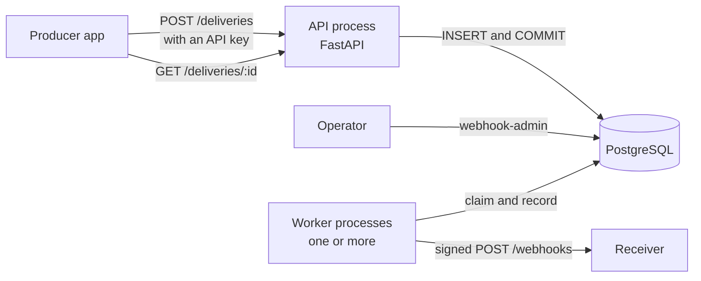
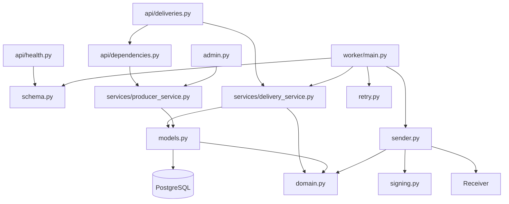
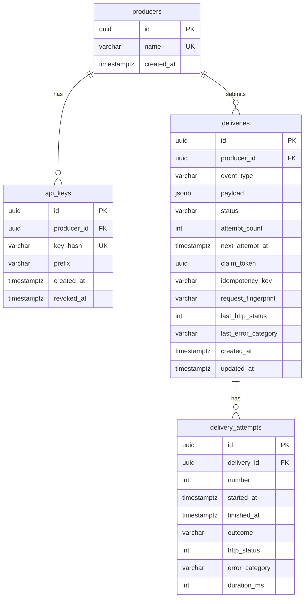
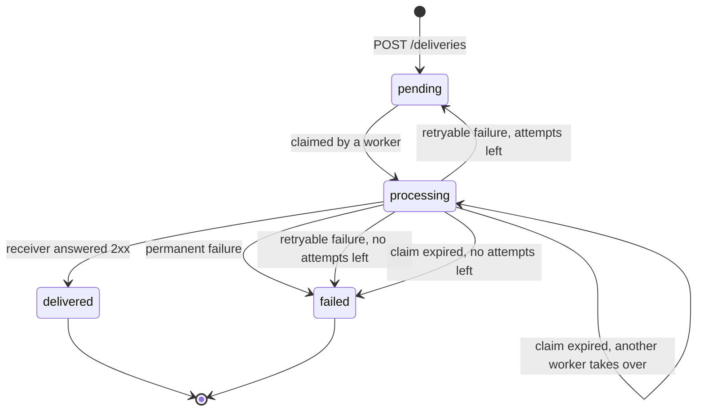
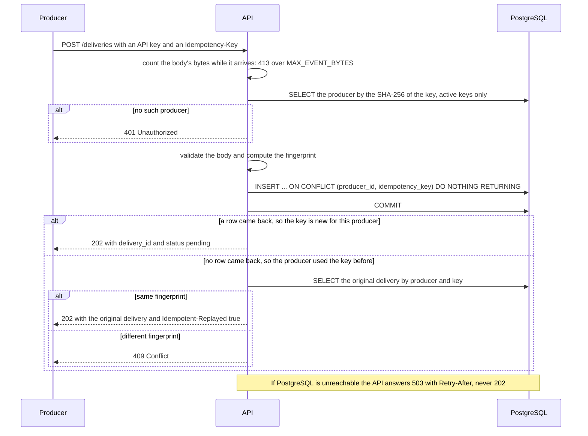
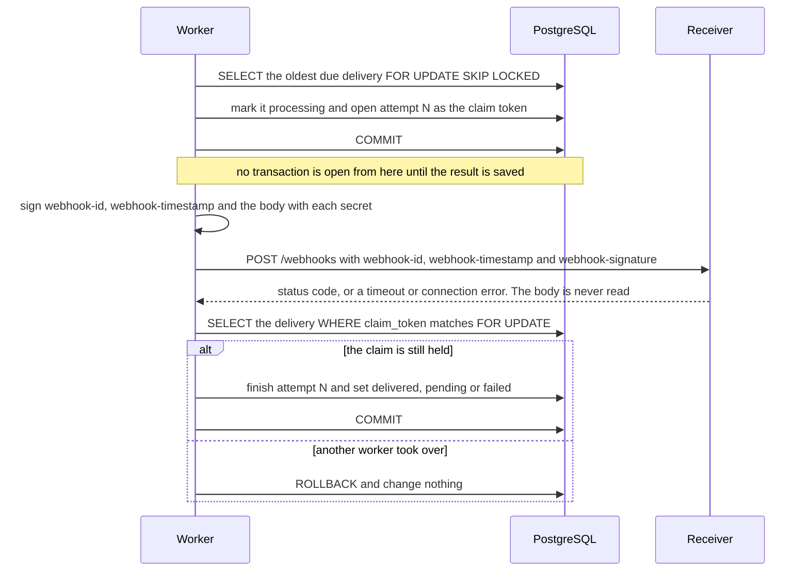
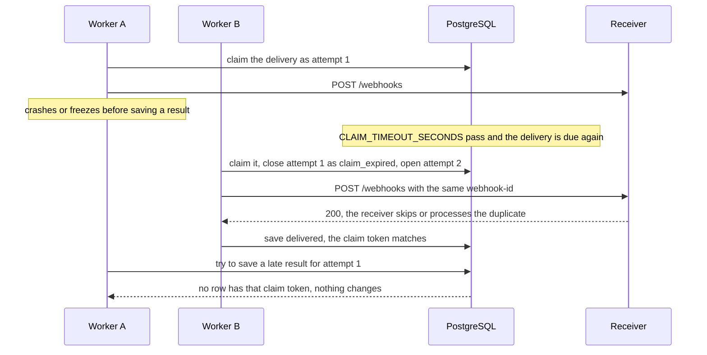
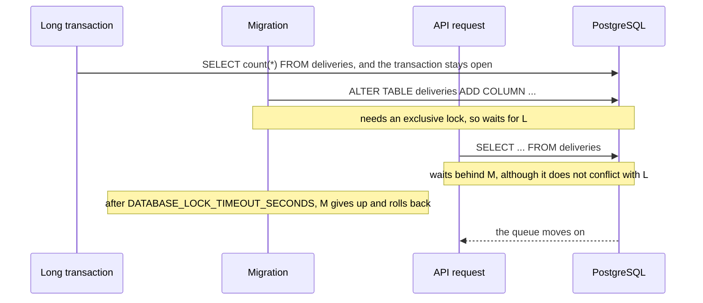
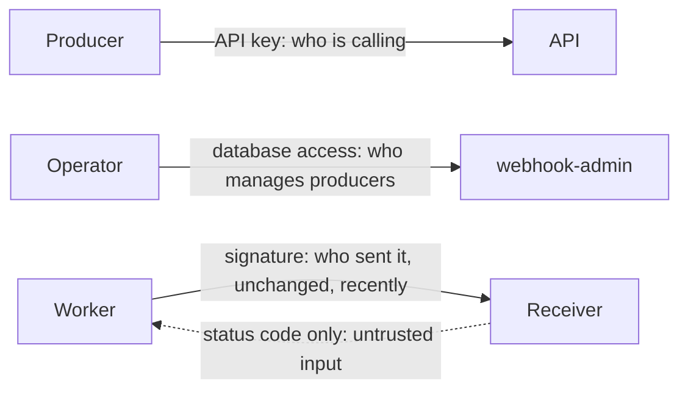

# Architecture

This document explains how the webhook delivery service is built and why. To run and use it, see
the [user manual](docs/USER_MANUAL.md). To see how the design grew one guarantee at a time, see
[how it was built](docs/MILESTONES.md).

## Contents

- [Goals and non-goals](#goals-and-non-goals)
- [System overview](#system-overview)
- [Components](#components)
- [Code structure](#code-structure)
- [Data model](#data-model)
- [Delivery state machine](#delivery-state-machine)
- [Flows](#flows)
- [Concurrency control](#concurrency-control)
- [Retry policy](#retry-policy)
- [Bounded waits](#bounded-waits)
- [Security model](#security-model)
- [Guarantees and failure modes](#guarantees-and-failure-modes)
- [Design decisions](#design-decisions)
- [Testing strategy](#testing-strategy)
- [Limitations and future work](#limitations-and-future-work)

## Goals and non-goals

**Goals**

- Accept events from producer applications and deliver them to a receiver over HTTP.
- State every guarantee explicitly and test it: what is stored, what can repeat, and what happens
  when a process dies at any moment.
- Let only registered producers in, keep their deliveries apart, and let the receiver check that
  every webhook is genuine.
- Keep the moving parts few: one codebase, one PostgreSQL database, two kinds of process.

**Non-goals for now**

- Destinations chosen by producers (a server-side request forgery risk), a receiver per producer,
  ordering guarantees and a dashboard.
- Message brokers such as Kafka, RabbitMQ or Redis, and Kubernetes. PostgreSQL is enough at this
  scale, and one system is easier to reason about.

## System overview



The API and the workers never call each other. The database is their only connection: the API
writes deliveries, and the workers claim, send and update them. That is why each side can stop,
restart or scale on its own. Both depend on PostgreSQL, which is the one shared point of failure.
Operators register producers and their API keys with `webhook-admin`, which also works on the
database directly.

## Components

| Component | Owns | Does not own |
|---|---|---|
| API: `main.py`, `api/deliveries.py`, `api/health.py` | Request validation, idempotent submission, reading deliveries, mapping errors to `409`, `422` and `503`, checking the settings at startup, liveness and readiness | Sending webhooks |
| API guards: `api/dependencies.py`, `api/body_limit.py` | The producer behind the API key (`401` otherwise), and the body-size limit (`413`) | Deciding what a producer may see: the service layer filters by producer |
| Service layer: `services/delivery_service.py` | Every delivery transaction: create, read, claim and record, each scoped to the producer where a producer is involved | HTTP on either side |
| Producers: `services/producer_service.py` | Producers and API keys: create, hash, look up, revoke | Any delivery |
| Admin command: `admin.py` | `webhook-admin`: producers, API keys and new webhook secrets | HTTP; it works on the database directly |
| Database access: `db.py`, `schema.py` | The engine and the limits on every wait, sessions, telling an unavailable database from a bug, and the schema revision the code needs | Transactions, which the service layer owns |
| Worker: `worker/main.py` | The loop (claim, send, record, wait), logging, clean stop on `SIGINT`/`SIGTERM`, waiting for the database and checking its schema at startup, carrying on through database outages and unexpected errors | Deciding what an attempt means: `sender.py` classifies it, `retry.py` sets the delay, and the service layer applies the attempt limit |
| Sender: `sender.py` | One signed HTTP attempt, classified by the status code alone; the response body is never read | Database state |
| Signing: `signing.py` | Standard Webhooks signatures: secrets, signing, and the verification receivers do | Where the secrets come from: `WEBHOOK_SECRETS` |
| Retry policy: `retry.py` | The delay before the next attempt | Whether to retry at all, which depends on the outcome and the attempt limit |
| Domain: `domain.py` | The shared vocabulary: delivery states, attempt outcomes, error categories and the attempt result | Any behavior; it imports nothing else from the service |
| PostgreSQL | Durable state, the queue, uniqueness, row locks, invariants enforced by constraints | Talking to receivers |
| Receiver (external) | Checking signatures, processing events, and skipping duplicates by `webhook-id` | Retrying, which the service does |

## Code structure



`domain.py` sits underneath everything: the database models, the sender and the service layer all
use its states and outcomes, and it uses none of them. In particular, the database models do not
depend on the HTTP sender.

Six rules keep the layers honest:

1. **The service layer owns the transactions.** HTTP handlers, the worker loop and the admin
   command contain no SQL and never commit; each service function commits its own work before it
   returns.
2. **No network call happens inside a database transaction.** The worker commits its claim before
   sending and opens a new transaction to record the result, so a slow receiver can never hold
   database locks.
3. **Code is synchronous.** SQLAlchemy and HTTPX2 are used in their blocking forms, and the API
   endpoints are plain `def` functions, which FastAPI runs in a thread pool. Throughput comes from
   running more workers, not from concurrency inside one.
4. **Answers from the receiver are untrusted input.** The sender reads only the status code and
   turns every kind of request failure into a classified result, and the worker loop survives
   any unexpected error. No answer can exhaust a worker's memory, hold it up or stop it.
5. **No secret is stored or printed in a usable form.** API keys are stored as hashes and shown
   once, webhook secrets live only in the environment, and a settings error never repeats the
   value it rejects.
6. **Every wait has a limit.** Every connection the service opens carries limits on statements,
   lock waits and idle transactions, and every wait for a connection is bounded too. When a limit
   runs out, the API answers `503` and the worker tries again. See
   [Bounded waits](#bounded-waits).

## Data model



`idempotency_key` is unique per producer, together with `producer_id`.

### `producers`

One row per application allowed to submit events.

| Column | Meaning |
|---|---|
| `id` | Producer ID. Every delivery refers to one. |
| `name` | For example `carrental`: lower-case letters, digits, `-` and `_`, checked by `webhook-admin`. Unique. Sent in every webhook's body as `producer`. |
| `created_at` | When it was registered. |

### `api_keys`

One row per key a producer has had. A producer can have several active keys, so keys can be
replaced without downtime.

| Column | Meaning |
|---|---|
| `id` | Key ID. |
| `producer_id` | The producer. Deleting a producer deletes its keys. |
| `key_hash` | SHA-256 of the key, in hex. The key itself is never stored. Unique, and how the API finds a key. |
| `prefix` | The key's first 12 characters, such as `wds_t408ROrX`, to tell keys apart in `webhook-admin list` and to revoke one. Not enough to use the key. |
| `created_at` | When it was created. |
| `revoked_at` | When it was revoked; `NULL` while it is active. Revoked keys are kept as history. |

### `deliveries`

One row per accepted event. The row is both the delivery's record and its queue entry, so the two
can never disagree.

| Column | Meaning |
|---|---|
| `id` | Delivery ID. Sent as `webhook-id` on every attempt. |
| `producer_id` | The producer that submitted it. Reads and idempotency keys are scoped to it, and its name is sent in the webhook. |
| `event_type` | For example `booking.confirmed`. |
| `payload` | The producer's `data` object, stored as JSONB. Key order and whitespace are not kept. |
| `status` | `pending`, `processing`, `delivered` or `failed`. |
| `attempt_count` | Attempts claimed so far, including any cut short before the request was sent. |
| `next_attempt_at` | While `pending`: when the delivery is due. While `processing`: when the current claim expires. Not meaningful once `delivered` or `failed`. |
| `claim_token` | ID of the attempt that holds the claim. Set only while `processing`. |
| `idempotency_key` | The producer's `Idempotency-Key`, if it sent one. Unique per producer. |
| `request_fingerprint` | SHA-256 of the request's canonical JSON, to detect a key reused with different content. |
| `last_http_status`, `last_error_category` | Result of the latest attempt whose worker saved it. An attempt closed as `claim_expired` by another worker does not change them. |
| `created_at` | When the delivery was accepted. Sent as the body's `timestamp`. |
| `updated_at` | When the row last changed. |

### `delivery_attempts`

One row per attempt, created when a worker claims the delivery and finished when the result is
saved. An attempt row proves that the delivery was claimed, not that a request was sent: an
attempt closed as `claim_expired` may or may not have reached the receiver.

| Column | Meaning |
|---|---|
| `id` | Attempt ID. While the attempt runs, this is also the delivery's `claim_token`. |
| `delivery_id` | The delivery. Deleting a delivery deletes its attempts. |
| `number` | 1, 2, 3 and so on, unique per delivery. |
| `started_at` | When the delivery was claimed for this attempt. |
| `finished_at` | When the result was saved, or when another worker found the claim expired. `NULL` while running. |
| `outcome` | `delivered`, `retryable_failure` or `permanent_failure`. `NULL` while running. |
| `http_status` | The receiver's status code, if it answered. |
| `error_category` | `timeout`, `connection_error`, `http_error` or `claim_expired`. |
| `duration_ms` | Time until the receiver's status code arrived, or until the request failed. |

### Constraints and indexes

The database enforces the invariants below, so neither a bug nor a manual edit can break them. It
does not enforce everything: that a claim token names an attempt of the same delivery, that
`attempt_count` matches the history, that each status change is an allowed transition, or that a
producer name follows the naming rule. The service layer keeps those, and the tests check them.

| Name | Rule | Why |
|---|---|---|
| `ck_deliveries_status_valid` | `status` is one of the four states | The state machine cannot be corrupted. |
| `ck_deliveries_claimed_while_processing` | `(status = 'processing') = (claim_token IS NOT NULL)` | Every in-flight delivery has exactly one owner, and no other row has one. |
| `ck_deliveries_attempt_count_not_negative` | `attempt_count >= 0` | Sanity. |
| `uq_deliveries_producer_id_idempotency_key` | `(producer_id, idempotency_key)` is unique; `NULL` keys are allowed | One delivery per key and producer. The basis of `ON CONFLICT`. Its index starts with `producer_id`, so it also serves lookups by producer. |
| `fk_deliveries_producer_id_producers` | Every delivery belongs to an existing producer | A producer with deliveries cannot be deleted. |
| `uq_producers_name` | Producer names are unique | Receivers tell producers apart by name. |
| `uq_api_keys_key_hash` | No two keys have the same hash | The API finds a key with one index lookup. |
| `fk_api_keys_producer_id_producers` | Every key belongs to an existing producer, and is deleted with it | No key outlives its producer. |
| `ix_api_keys_producer_id` | Index on `api_keys.producer_id` | Lists a producer's keys. |
| `ck_delivery_attempts_outcome_valid` | `outcome` is `NULL` or one of three values | Valid history. |
| `ck_delivery_attempts_finished_with_outcome` | `(finished_at IS NULL) = (outcome IS NULL)` | An attempt is either running, or finished with an outcome. |
| `uq_delivery_attempts_delivery_id` | `(delivery_id, number)` is unique | No two attempts share a number. Also indexes lookups by delivery. |
| `ix_deliveries_due` | Index on `next_attempt_at` `WHERE status IN ('pending', 'processing')` | Serves the claim query. Finished deliveries, which become most rows over time, are left out. |

Migrations live in `alembic/versions`:

| Migration | Change |
|---|---|
| `0001` | `deliveries` table with status and attempt-count checks. |
| `0002` | Last-attempt columns and an index for due `pending` rows. |
| `0003` | `delivery_attempts`, claim tokens, idempotency columns and the claim constraint. It also moves rows left in `processing` by the old, non-expiring claims back to `pending` before adding the constraint. |
| `0004` | `producers`, `api_keys` and `deliveries.producer_id`, with idempotency keys unique per producer. Deliveries stored before it are given a producer named `legacy`, created only if there are any, before the column becomes required. |

CI runs `alembic upgrade head` and `alembic check`, so a model change without a migration fails the
build. Migrations are numbered `0001`, `0002` and so on, and `schema.REQUIRED_REVISION` names the
newest one the code needs; a test checks both. A migration waits at most
`DATABASE_LOCK_TIMEOUT_SECONDS` for each lock; see [the lock queue](#the-lock-queue-and-migrations).

## Delivery state machine



| Trigger | From | To | Guard | Writes |
|---|---|---|---|---|
| `POST /deliveries` | none | `pending` | Valid request; the key is unused or was used with the same content | Insert the delivery. |
| Claim | `pending` | `processing` | `next_attempt_at <= now()` and the row is not locked | `attempt_count + 1`, new attempt row, `claim_token` = attempt ID, `next_attempt_at = now() + CLAIM_TIMEOUT_SECONDS`. |
| Claim (takeover) | `processing` | `processing` | The claim expired and attempts are left | Close the old attempt as `claim_expired`, then as above. |
| Claim (exhausted) | `processing` | `failed` | The claim expired and `attempt_count >= MAX_ATTEMPTS` | Close the old attempt as `claim_expired`; clear `claim_token`. |
| Record a 2xx | `processing` | `delivered` | `claim_token` matches | Finish the attempt; clear `claim_token`. |
| Record a retryable failure | `processing` | `pending` | `claim_token` matches and `attempt_count < MAX_ATTEMPTS` | Finish the attempt; `next_attempt_at = now() + backoff`. |
| Record the last retryable failure | `processing` | `failed` | `claim_token` matches and `attempt_count >= MAX_ATTEMPTS` | Finish the attempt. |
| Record a permanent failure | `processing` | `failed` | `claim_token` matches | Finish the attempt. |
| Late result from a stale worker | any | unchanged | `claim_token` does not match: another worker took the delivery over, or closed it | Nothing. |

Expiry and revocation are different things. When a claim expires, the delivery becomes claimable
again, but the old worker's token stays valid until another worker actually takes the delivery
over. A worker that reports late, before any takeover, still has its result saved. Only a takeover
revokes a claim, by replacing the token.

## Flows

### Submitting an event



Without an `Idempotency-Key`, the API does a plain `INSERT` and `COMMIT`. In every case the commit
happens before the response is sent, so `202` always means "stored".

The opposite does not hold: a `503` does not prove that nothing was stored. If the connection
fails while the API is committing, PostgreSQL may have committed without the API hearing back.
That is why the `503` message tells the producer to retry with the same `Idempotency-Key`: the
retry either stores the delivery or finds the stored one and replays it. A test commits, then
raises a connection error, and checks exactly that.

### Delivering



### Crash takeover and fencing



The claim token fences writes to the database, not effects at the receiver. Worker A's request
cannot be recalled: if it reached the receiver, the receiver gets the event twice, once from each
worker, possibly at the same time. Receivers handle that by skipping `webhook-id`s they have
already processed.

## Concurrency control

The statements below are what SQLAlchemy sends, shortened for reading.

**Claim**, one short transaction:

```sql
SELECT * FROM deliveries
WHERE status IN ('pending', 'processing') AND next_attempt_at <= now()
ORDER BY next_attempt_at
LIMIT 1
FOR UPDATE SKIP LOCKED;

-- Only if the row was 'processing': its claim expired, so close the lost attempt.
UPDATE delivery_attempts
SET finished_at = now(), outcome = 'retryable_failure', error_category = 'claim_expired'
WHERE id = :old_claim_token;

UPDATE deliveries
SET status = 'processing', attempt_count = :n, claim_token = :attempt_id,
    next_attempt_at = now() + :claim_timeout, updated_at = now()
WHERE id = :id;

INSERT INTO delivery_attempts (id, delivery_id, number) VALUES (:attempt_id, :id, :n);
COMMIT;
```

**Record**, one short transaction, fenced by the claim token:

```sql
SELECT * FROM deliveries WHERE id = :id AND claim_token = :attempt_id FOR UPDATE;
-- No row: this attempt lost its claim. Roll back and change nothing.

UPDATE delivery_attempts
SET finished_at = now(), outcome = :outcome, http_status = :status,
    error_category = :category, duration_ms = :ms
WHERE id = :attempt_id;

UPDATE deliveries
SET status = :new_status, claim_token = NULL,
    next_attempt_at = now() + :retry_delay,  -- only when retrying
    last_http_status = :status, last_error_category = :category, updated_at = now()
WHERE id = :id;
COMMIT;
```

**Idempotent submission**:

```sql
INSERT INTO deliveries (id, producer_id, event_type, payload, idempotency_key, request_fingerprint)
VALUES (...)
ON CONFLICT (producer_id, idempotency_key) DO NOTHING
RETURNING *;
-- No row returned: select the producer's delivery with that key and compare fingerprints.
```

| Operation | Transaction | Locks | Why it is safe |
|---|---|---|---|
| Claim | Short, no network call | One row, `FOR UPDATE SKIP LOCKED` | Workers never wait for, or take, a row another worker is claiming. An expired claim is simply a due row. |
| Send | None | None | A slow or hanging receiver cannot hold database locks. |
| Record | Short | The delivery row, `FOR UPDATE` | The token check and the write are atomic. A stale worker's token no longer matches. |
| Submit with a key | Short | The unique-index entry | A concurrent insert of the same key waits for the first, then does nothing. If the first rolls back instead, the waiting insert goes ahead and stores its own delivery. |

`FOR UPDATE` on the record step matters most when a takeover is in progress. The late worker's
`SELECT` then waits for the takeover's row lock. When the takeover commits, PostgreSQL evaluates
the `WHERE` clause again on the new version of the row, finds the new token, and returns nothing.
Without `FOR UPDATE`, the `SELECT` would read the old token from before the takeover, and the late
worker's writes would land on top of it. A test pauses a real takeover before its commit to check
this; the sequential takeover test could not catch it.

Four details make the claim work:

- **`next_attempt_at` doubles as the claim expiry.** A claim moves it to
  `now() + CLAIM_TIMEOUT_SECONDS`. If no result is saved by then, the row is due again and the
  ordinary claim query picks it up. Message queues call this a visibility timeout. One index and
  one query serve both new work and abandoned work.
- **The claim token is the attempt's ID.** No extra state is needed, and the history records
  exactly which claim did what.
- **Attempts are counted when claimed,** not when their result is saved. A delivery that crashes
  every worker that sends it still reaches `MAX_ATTEMPTS` and fails.
- **Expiry is not revocation.** An expired claim only makes the delivery claimable. Until another
  worker takes it over, the old worker's token still matches, and a late result is saved.

All timestamps come from `now()`, which PostgreSQL fixes at the start of each transaction. These
transactions run a few statements and wait for locks only as long as another short transaction
holds them, so `now()` stays within milliseconds of the wall clock.

## Retry policy

Each attempt ends in one of three outcomes:

| Receiver result | Outcome |
|---|---|
| 2xx | `delivered` |
| 5xx, 408 or 429; connection refused or dropped; no answer within `DELIVERY_TIMEOUT_SECONDS` | `retryable_failure` |
| Other 4xx, or a 3xx redirect (redirects are never followed) | `permanent_failure` |

Only the status code is used. The worker closes the connection without reading the response body,
so a receiver cannot make it download a large body, wait for a slow one, or fail on one that does
not decode.

After a retryable failure, the wait before the next attempt is:

```text
nominal = min(RETRY_MAX_DELAY_SECONDS, RETRY_BASE_DELAY_SECONDS × 2^(attempt − 1))
wait    = min(RETRY_MAX_DELAY_SECONDS, nominal × random(0.8, 1.2))
```

The wait doubles so that brief blips are retried quickly while long outages are not hammered. The
random factor spreads out deliveries that failed together, so a receiver coming back from an outage
is not hit by all of them at the same moment. The second `min` keeps the random factor from
pushing a wait past `RETRY_MAX_DELAY_SECONDS`, so the maximum really is the maximum. The limit
turns a hopeless delivery into a visible `failed` one, and tells receivers how long they must
remember `webhook-id`s.

With the defaults (10-second base, 1-hour cap, 8 attempts), give or take 20%:

| Attempt | Starts after the first | Wait if it fails |
|---|---|---|
| 1 | 0 s | 10 s |
| 2 | about 10 s | 20 s |
| 3 | about 30 s | 40 s |
| 4 | about 70 s | 80 s |
| 5 | about 2.5 min | 160 s |
| 6 | about 5 min | 320 s |
| 7 | about 10.5 min | 640 s |
| 8 | about 21 min | none; the delivery becomes `failed` |

## Bounded waits

A wait without a limit turns one stuck transaction, a frozen process or a broken network into
requests and workers that pile up until nothing answers. With a limit, the same fault becomes a
quick error with a known way on: the API answers `503` and the producer retries, and the worker
logs the error and tries again on its next poll.

| Wait | Who waits | Limit | Default | When it runs out |
|---|---|---|---|---|
| Opening a database connection | API, worker, `webhook-admin` | `DATABASE_CONNECT_TIMEOUT_SECONDS` | 5 s | The connection fails: `503`, or the worker tries again. |
| A free connection from the pool | API, worker | `DATABASE_POOL_TIMEOUT_SECONDS` | 2 s | `503`, or the worker tries again. |
| One statement, waiting for locks included | API, worker | `DATABASE_STATEMENT_TIMEOUT_SECONDS` | 5 s | PostgreSQL cancels it, and its transaction rolls back: `503`, or the worker tries again. |
| A lock that another transaction holds | API, worker | `DATABASE_LOCK_TIMEOUT_SECONDS` | 2 s | As for a statement. |
| A lock, in a migration | `alembic upgrade` | `DATABASE_LOCK_TIMEOUT_SECONDS` | 2 s | The migration fails and rolls back. Run it again later. |
| A transaction of the service's that sits idle between statements, holding its locks, because its process froze | Everyone who needs those locks | `DATABASE_IDLE_IN_TRANSACTION_TIMEOUT_SECONDS` | 10 s | PostgreSQL ends that session, which releases its locks. Other sessions, such as an operator's, are not limited. |
| An answer over a network that died without a word | API, worker | TCP keepalives and `TCP_USER_TIMEOUT`, set in `db.py` | about 25 s | The connection fails. |
| Each network step of an attempt | Worker | `DELIVERY_TIMEOUT_SECONDS` | 5 s | The attempt is a `timeout`, and is retried. |
| The claim of a worker that died | Other workers | `CLAIM_TIMEOUT_SECONDS` | 60 s | Another worker takes the delivery over. |
| The database, while a worker starts | Worker | None, on purpose | | It tries again every `POLL_INTERVAL_SECONDS` and logs each try. A database that starts after the worker is normal. |
| A slow client reading its response | Nobody | Not needed | | The request's session ends before the response is sent, so it holds nothing. |

### Limits set on every connection

`db.create_db_engine` passes the three PostgreSQL limits as startup options of every connection
(`-c statement_timeout=5000` and so on), and sets the pool timeout, the connect timeout and the
TCP settings. The API, the worker, `webhook-admin` and the tests all build their engines with it.
The limits hold for every statement the service runs and for nothing else, so an operator's own
`psql` session, which may legitimately run a long maintenance statement, is not cut short.

- The lock timeout must be shorter than the statement timeout. Waiting for a lock counts towards
  the statement timeout, so a lock timeout that is not shorter would never be reached. The
  settings refuse it.
- A statement that runs out of time is cancelled with `QueryCanceled` or `LockNotAvailable`,
  which SQLAlchemy raises as `OperationalError`. That is the class an unreachable database
  raises, which the API's `503` handler and the worker already handled, so a timeout is treated
  the same way: the producer retries with the same `Idempotency-Key`, and the worker tries again.
- The idle-in-transaction timeout is different: PostgreSQL ends the whole session, and the next
  statement on it raises `InternalError`, with the connection marked as invalidated.
  `db.storage_unavailable` counts that as the database being unavailable, not as a bug, so the
  worker logs it as a database error. The pool replaces the connection.
- The worker's log names the reason, such as `database error (canceling statement due to lock
  timeout)`, so a lock held too long is not mistaken for an outage.

### The lock queue and migrations

PostgreSQL grants the locks on a table in the order they were asked for. `ALTER TABLE` needs an
exclusive lock, so a migration waits until every open transaction that has used the table ends.
While it waits, it holds a place in the queue, and every later query on that table waits behind
it, even a plain `SELECT` that does not conflict with the transaction the migration waits for:



Measured on a copy of the schema at `0003`: while migration `0004` waited for one open reader, an
ordinary `SELECT` waited behind it for as long as the reader stayed open, 5 seconds in the probe.
One forgotten transaction can therefore stop every request through a migration that is only
waiting. So `alembic/env.py` gives migrations the lock timeout too. In the same probe, the
migration then gave up after 2.0 seconds, the `SELECT` finished at 2.0 seconds, the database was
still at `0003`, and running the migration again once the reader had ended succeeded.
Migrations get no statement timeout: changing data may take as long as it needs. A migration that
gives up changes nothing, because PostgreSQL runs schema changes in a transaction.

### Sessions end before the response is sent

In FastAPI 0.165, a dependency with `yield` ends after the response has been sent, unless it is
declared with `scope="function"`. The database session was such a dependency, so every request
kept its pooled connection, and its transaction with the locks it held, while the response
traveled to the client. A client reading slowly, or not at all, held them for as long as it
liked. `SessionDep` now uses `scope="function"`: the session closes as soon as the route function
returns. The route functions build their whole response first, so nothing reads the database
later. A test wraps the app and checks that no pooled connection is in use when the response
starts.

### Dead and frozen connections

If the database host dies, or the network to it breaks, nothing tells the client: TCP just waits.
By default, Linux sends the first keepalive probe after two hours of silence, and retransmits
data that is never acknowledged for about fifteen minutes. `db.py` sets keepalive probes after
10 seconds of silence, every 5 seconds, and a `TCP_USER_TIMEOUT` of 25 seconds, after which a
connection that hears nothing back fails.

This was measured with a throwaway PostgreSQL container cut off its Docker network. One query
was waiting for its answer when the network was cut, and another was sent afterwards:

| Connection settings | Waiting for an answer | Sent after the cut |
|---|---|---|
| The service's | Failed after 25 seconds | Failed after 26 seconds |
| libpq's defaults | Still waiting after 90 seconds | Still waiting after 90 seconds |

The client ran in a container on the same network. From the host, Docker Desktop's port
forwarding answers TCP on the container's behalf, so the cut would not have been visible.

A database that stops working while its network stack keeps answering, as a paused container
does, cannot be noticed this way: the probes are answered. With a paused container, a new
connection still failed after the connect timeout, 5.0 seconds, because the server never
finished the handshake. But a query already sent on an open connection waited for the whole
pause, 20 seconds, and finished once the container resumed. `statement_timeout` cannot help,
because the frozen server keeps that clock. A deadline on every query, kept by the client, would
need asynchronous database access with cancellation. At this scale the remedy is to monitor the
database itself.

### Liveness, readiness and the schema

| Endpoint | Question | Checks | Used to |
|---|---|---|---|
| `GET /health` | Is the process alive? | Nothing outside the process | Restart an API that stopped answering |
| `GET /ready` | Can it serve requests now? | That a pooled connection can be had, and that the schema is recent enough | Send it traffic, or not |

- `/health` does not use the database. If it did, a database outage would make every API instance
  look dead, and restarting them all would not bring the database back. It would only add
  restarts and dropped requests to the outage.
- `/ready` answers `503` with a reason when the database is unavailable or too busy, or when its
  schema is behind the code. It needs no API key, because whatever routes traffic calls it.
- "Recent enough" means at least `schema.REQUIRED_REVISION`, not exactly it. Migrations run
  before new code replaces old code, so for a while old code runs against the newer schema, and
  each migration must keep it working: add first, and remove only once no code uses the old
  shape. If old code went unready as soon as a migration ran, every deploy would take the service
  down. Revisions are numbered in order, so comparing their numbers tells which is later; a test
  keeps them that way.
- The worker checks the same thing when it starts. If the database cannot be reached, it waits
  and tries again: a database that starts after the worker is normal. If the schema is behind, it
  exits with the revision it needs. Every claim would fail, and before 5.2 the worker logged that
  same error on every poll, for as long as nobody noticed.
- The API does not refuse to start against an old schema. It must stay up to answer `/health`
  and `/ready`, and readiness keeps traffic away from it until the migrations have run.

## Security model

Trust crosses three boundaries, and each has its own proof:



| Boundary | Threat | Defense |
|---|---|---|
| Producer to API | Anyone who can reach the API submits or reads events | An API key on every request to `/deliveries` |
| Producer to API | One producer reads, or interferes with, another's deliveries | Every read and every idempotency key is scoped to the producer; another producer's delivery is `404` |
| Producer to API | A huge body uses up the API's memory or fills the database | `MAX_EVENT_BYTES`, enforced while the body arrives |
| Producer to API | A producer makes the service call an internal address (SSRF) | One configured destination; unknown fields are rejected |
| Worker to receiver | Someone else posts a fake webhook to the receiver | An HMAC-SHA256 signature with a secret only the workers and the receiver have |
| Worker to receiver | A webhook is changed on the way | The signature covers the exact body |
| Worker to receiver | A captured webhook is sent again later | The signed timestamp and the receiver's age check; within the age limit, the signed `webhook-id` and the receiver's duplicate check |
| Receiver to worker | An answer uses up, holds up or crashes the worker | Only the status code is read; see [Retry policy](#retry-policy) |
| Database copies | A leaked copy gives access | Only key hashes are stored, and webhook secrets are not in the database |
| Logs | Secrets end up in logs | Settings errors never repeat a value, and keys and secrets are never logged |

### Producer authentication

- A key is `wds_` followed by 32 random bytes in URL-safe base64, 47 characters in all. The prefix
  makes a leaked key easy to recognize, for people and for secret scanners.
- The database stores the key's SHA-256 under a unique index, and its first 12 characters for
  display. The API hashes the key it receives and looks the hash up: one index lookup.
- SHA-256 rather than bcrypt or Argon2. A slow hash protects passwords, which people choose and
  attackers can guess, after a database leak. A key has 256 random bits, so no amount of guessing
  finds one, however fast. A slow hash would only add CPU time to every request, and because it is
  salted, it could not be looked up by index at all.
- The lookup compares hashes, never keys. Timing it would tell an attacker about the hashes of
  their own guesses, which says nothing about real keys.
- A missing key gets `401` without touching the database. An unknown key and a revoked one get the
  same `401`, with `WWW-Authenticate: Bearer`, so the answer does not reveal which keys existed.
- Revoking a key sets `revoked_at`; the next request with it gets `401`. The row stays as history.
  Because a producer can have several active keys, a key is replaced without downtime.
- Producers and keys are created with `webhook-admin`, on the database. An administration endpoint
  would need an administrator credential of its own, and would widen what the API exposes.

### Producer isolation

- `create_delivery` and `get_delivery` take the producer's ID, and their queries filter by it.
- Idempotency keys are unique per producer. With one set of keys for all producers, a second
  producer that sent the same key with the same content would be told its event was stored, and
  get the first producer's delivery back; with different content it would get `409`. Producers
  could collide, and could find out which keys another producer had used.
- Another producer's delivery gets `404`, exactly like an unknown ID. A `403` would confirm that
  the ID exists.
- Every webhook names its producer inside the signed body. Producers choose event types freely, so
  without it a receiver could not tell friendster's `booking.confirmed` from carrental's. A header
  would not do: only the body, the ID and the timestamp are signed.

### Webhook signatures

Signing follows [Standard Webhooks](https://www.standardwebhooks.com), version `v1`:

```text
signed content     = webhook-id + "." + webhook-timestamp + "." + body
signature          = base64(HMAC-SHA256(key, signed content))
webhook-signature: v1,<signature> v1,<signature with the next secret> ...
```

- The key is the base64 part of a `whsec_` secret, 24 to 64 bytes; `webhook-admin
  new-webhook-secret` makes 32.
- The worker encodes the body once, signs those bytes, and sends them unchanged.
- Each attempt is signed with its own timestamp, so a legitimate retry hours later still passes
  the receiver's five-minute age check. `webhook-id` stays the same on every attempt.
- Each signed part has a job. The body gives integrity. The timestamp stops a replay from being
  made to look recent. The ID stops a replay from being renamed past the duplicate check. A replay
  within the five minutes is identical to the original, so the receiver's duplicate check by
  `webhook-id`, which at-least-once delivery needs anyway, catches it.
- The worker signs with every secret in `WEBHOOK_SECRETS`, and receivers accept any matching
  signature. Signing with the old and the new secret for a while lets the receiver switch at any
  moment, so rotation needs no downtime.
- Verification compares bytes in constant time, with `hmac.compare_digest`, so an unusual
  character in a header cannot raise an error either.
- The worker does not start without a secret. With optional signing, a missing setting would
  silently send unsigned webhooks, and a receiver that accepts unsigned webhooks is protected by
  nothing.
- A test reproduces the specification's own test vector. Signatures made by the service were also
  checked with the specification's Python and JavaScript libraries.

### Configuration and secrets

- Settings errors never repeat the rejected value (`hide_input_in_errors`). Pydantic includes the
  input by default, which would have put webhook secrets, or the password in `DATABASE_URL`, into
  startup logs.
- `WEBHOOK_SECRETS` is a list of `SecretStr`, which prints as `**********`.
- The API reads its settings at startup, so an invalid value stops it with a clear message instead
  of failing every request with `500`.
- `.env` is ignored by Git, and `.env.example` holds no secret.

### Not covered

- **Encryption in transit.** A signature proves who sent a webhook and that it is unchanged, not
  that nobody read it. TLS belongs to the deployment: a reverse proxy in front of the API, and an
  `https://` receiver.
- **Rate limits.** A producer with a valid key can submit as fast as the database accepts.
- **Key expiry and usage.** Keys are valid until revoked, and their last use is not recorded.
- **Public-key signatures.** With one receiver run by the same team, a shared secret is enough.
  For third-party receivers, the specification's asymmetric scheme (`v1a`) would mean no receiver
  holds a secret that can sign.
- **Database access.** Whoever can write to the database can create keys. Database credentials
  are the operator's boundary.

## Guarantees and failure modes

**Guarantees**

1. **Durable acceptance.** `202` is sent only after the commit is confirmed. If the database is
   unreachable, the answer is `503` with `Retry-After`, never `202`. A `503` does not prove that
   nothing was stored, so producers retry with the same `Idempotency-Key`.
2. **At-least-once delivery, within the retry window.** Every accepted delivery is attempted until
   it is delivered, fails permanently or runs out of attempts. Every attempt carries the same
   `webhook-id`, so receivers can drop duplicates. A delivery that runs out of attempts ends as
   `failed`, visibly, rather than being retried forever.
3. **Idempotent submission.** Repeating a request with the same `Idempotency-Key` returns the
   original delivery, even when the repeats arrive at the same moment.
4. **Crash recovery.** A delivery claimed by a worker that dies is retried after
   `CLAIM_TIMEOUT_SECONDS`. Once another worker has taken the delivery over, the old worker cannot
   change anything in the database. It cannot recall a request it already sent, though.
5. **Bounded retries.** At most `MAX_ATTEMPTS` attempts, with growing, randomized delays that never
   exceed `RETRY_MAX_DELAY_SECONDS`.
6. **No ordering guarantee.** A retried event can arrive after a newer one.
7. **Untrusted answers stay harmless.** The worker reads only the receiver's status code, and no
   answer can make it read a body, run out of memory or stop.
8. **Authenticity.** Every webhook is signed over its ID, timestamp and body. A receiver that
   checks the signature, the timestamp and the ID accepts genuine webhooks, and refuses forged,
   changed and replayed ones.
9. **Isolation.** Only requests with an active API key are served. A producer reads only its own
   deliveries, and its idempotency keys cannot collide with another producer's.
10. **Bounded waits.** Every wait on the database has a limit, with one exception: a query already
    sent to a database that freezes while its network stack keeps answering waits until it
    resumes.

| What fails | What happens | Result |
|---|---|---|
| API process crashes | Accepted deliveries are already committed, and workers keep sending | A producer whose request was cut off retries; its `Idempotency-Key` prevents a second copy. |
| PostgreSQL unreachable | The API answers `503` with `Retry-After`, and `/ready` answers `503` while `/health` stays `200`; workers log a database error and poll again | Nothing new is accepted or sent until it returns. No restart is needed, because pooled connections are checked before use. |
| The connection fails during the API's `COMMIT` | The API answers `503`, although the delivery may be stored | The producer's retry with the same key finds it and gets it back, marked `Idempotent-Replayed`. |
| Every pooled database connection is busy | The API waits up to `DATABASE_POOL_TIMEOUT_SECONDS` for one, then answers `503` | Producers retry. |
| A transaction holds a lock that a request needs | The request waits up to `DATABASE_LOCK_TIMEOUT_SECONDS`, then answers `503` | The producer retries with the same key. Other requests are not held up. |
| A process freezes in the middle of a transaction | PostgreSQL ends its session after `DATABASE_IDLE_IN_TRANSACTION_TIMEOUT_SECONDS` | Its locks are released and its work is rolled back. A worker's lost claim or result is recovered as after a crash. |
| A statement runs too long, for example in an overloaded database | PostgreSQL cancels it after `DATABASE_STATEMENT_TIMEOUT_SECONDS` | `503`, or the worker tries again. |
| A migration waits behind a long transaction | It gives up after `DATABASE_LOCK_TIMEOUT_SECONDS` and rolls back | Requests are held up at most that long. Run the migration again. |
| The network to the database dies without a word | Connections fail after about 25 seconds | `503`, or the worker tries again. |
| The database freezes, its network stack still answering | New connections fail after `DATABASE_CONNECT_TIMEOUT_SECONDS`; queries already sent wait | They finish when it resumes. A known gap: monitor the database. |
| The database's schema is behind the code | `/ready` answers `503` with the reason; a worker that starts exits, naming the revision it needs | Run the migrations. |
| The database is down when a worker starts | The worker waits, logging each try | It starts working once the database is back. |
| A client reads its response slowly | The request's session has already ended | Nothing waits for that client. |
| Receiver down, 5xx, 408, 429 or timeout | Retried with growing delays, up to `MAX_ATTEMPTS` | Then `failed`, which is visible. |
| Receiver answers another 4xx or a 3xx | `failed` immediately | Visible as `permanent_failure`. |
| Receiver sends a large, slow or corrupt response body | The body is never read | The attempt is classified by its status code. |
| Receiver sends its status line a few bytes at a time | The attempt can outlast its claim | Another worker sends the delivery again, and the late result is discarded. A duplicate, never a corrupted state. |
| Receiver processed the event but its answer was lost | Retried with the same `webhook-id` | A duplicate, which the receiver must skip. |
| Worker crashes before sending | The claim expires and another worker sends it | Delayed by up to `CLAIM_TIMEOUT_SECONDS`. |
| Worker crashes after the receiver processed it | The claim expires and it is sent again | A duplicate, recorded as `claim_expired`. |
| The database fails while a worker saves a result | Same as a crash: the claim expires and the delivery is sent again | A duplicate, recorded as `claim_expired`. |
| Worker freezes past its claim, then wakes up | If another worker has taken over, its late result is discarded; if not, it is saved | No overwrite either way. |
| Unexpected error in the worker, such as a bug | Logged with its traceback; the worker carries on with other deliveries | The delivery it held is sent again when its claim expires. |
| Worker stopped with Ctrl+C or `SIGTERM` | It finishes the current delivery first | No claim is left behind. |
| Two workers reach the same delivery at once | `SKIP LOCKED`: one claims it, the other moves on | The race itself never sends twice. |
| The producer's `202` is lost | The producer retries with the same key | It gets the original delivery back, marked `Idempotent-Replayed`. |
| The same key is used with different content | `409 Conflict` | A producer bug is surfaced instead of hidden. |
| A delivery crashes every worker that sends it | Attempts are counted when claimed | It fails after `MAX_ATTEMPTS`. |
| `RECEIVER_URL` is changed | Deliveries waiting for a retry go to the new URL | Intended for moving the receiver. Every worker needs the same value. |
| A request has no valid API key | `401` before anything is stored; without a key, before the database is used | Nothing changes. |
| A producer asks for another producer's delivery | `404`, as for an unknown ID | Nothing is revealed. |
| A body is larger than `MAX_EVENT_BYTES` | `413` while it arrives, before it is read into memory | Memory use stays bounded. |
| The receiver refuses the signature with `401` | Like any other 4xx: `failed` at once | Fix the secrets, then replay. |
| `WEBHOOK_SECRETS` is not set | The worker does not start | No unsigned webhook is ever sent. |
| A setting is invalid | The API and the worker stop at startup, naming the setting but not its value | No secrets in logs, and no API that fails every request. |
| An API key leaks | Revoke it; the next request with it gets `401` | Deliveries it submitted are kept and delivered. |
| A webhook secret leaks | Rotate it, signing with both secrets for a while | No webhook fails during the rotation. |

## Design decisions

| Decision | Alternative | Why |
|---|---|---|
| A PostgreSQL table as the queue | Redis, RabbitMQ or Kafka | One system to run and back up. The delivery record and its queue entry are the same row, so they cannot disagree. `SKIP LOCKED` makes it a safe work queue at this scale. |
| A separate worker process | FastAPI `BackgroundTasks` | Background tasks live inside the API process: they vanish when it restarts and are never retried. |
| Store first, answer `202` | Send during the request | Accepting events no longer depends on the receiver, and `202` means "stored". |
| `SELECT … FOR UPDATE SKIP LOCKED` to claim | Advisory locks, or a status check alone | Concurrent workers skip each other's rows instead of waiting. A status check alone let two workers claim the same row. |
| `next_attempt_at` as the claim expiry | A separate `claimed_until` column | One index and one query serve both due and abandoned rows. |
| The attempt ID as the claim token | A version counter or a separate token | The history row identifies the claim holder. No extra state. |
| Count attempts at claim time | Count when the result is saved | A delivery that crashes workers still runs out of attempts. |
| A write fenced by `claim_token` | A status check | After a takeover the status is `processing` again; only a token tells the claims apart. |
| `INSERT … ON CONFLICT DO NOTHING` | Check, then insert; or catch the unique-key error | Atomic under concurrency, with no exception handling. |
| A fingerprint of canonical JSON | Comparing raw bodies | Key order and whitespace do not cause false conflicts. |
| Exponential backoff with ±20% jitter, a cap and a limit | A fixed delay forever | Spares struggling receivers, spreads out synchronized retries, and ends in a visible failure. |
| Cap the wait again after the jitter | Cap only the nominal wait | `RETRY_MAX_DELAY_SECONDS` then really is the longest wait. |
| Classify by the status code and never read the body | Read the whole response | The body is not part of the contract. Reading it let a receiver use up the worker's memory, keep it busy past its claim, or crash it with a body that does not decode. |
| Classify every request error in the sender | Catch only transport errors | Anything the receiver can trigger becomes a retryable result instead of an exception that stops the worker. |
| Keep the worker running after an unexpected error | Let the process crash | One bad delivery or bug should not stop every other delivery. Attempts counted at claim time still end a delivery that keeps failing. |
| Deliveries waiting for a retry follow the current `RECEIVER_URL` | Save the URL on each delivery | Saving it would leave waiting deliveries at the old address after a planned move. With several receivers, deliveries would point to a destination by ID instead, whose URL could change. |
| A `503` that says the outcome is unknown | "Not accepted" | A connection can fail after PostgreSQL committed, so "not accepted" would sometimes be false. The `Idempotency-Key` makes the retry safe either way. |
| Shared types in `domain.py` | Enums in `models.py` and `sender.py` | The database models no longer depend on the HTTP sender. |
| Standard Webhooks headers and body | A custom format | Receivers can use existing libraries, and signing follows the same specification. |
| API keys looked up by hash in the database | JWTs, or OAuth 2 client credentials | A few known producers, all server-side. Keys are simple to issue and are revoked at once; a JWT stays valid until it expires unless a deny list is added. |
| SHA-256 for API keys | bcrypt or Argon2 | A key has 256 random bits, so guessing is hopeless even against a fast hash. A slow, salted hash would cost CPU on every request and rule out the index lookup. |
| `404` for another producer's delivery | `403` | A `403` would confirm that the ID exists. |
| Idempotency keys unique per producer | Unique across the service | Producers can neither collide with nor probe each other's keys. |
| The producer's name in the signed body | A header | Only the body, `webhook-id` and `webhook-timestamp` are signed. |
| Symmetric HMAC signatures (`v1`) | Public-key signatures (`v1a`), or a custom scheme | One receiver, run by the same team; a library exists for every common language. Public keys add a dependency and a way to distribute them. |
| A new signature for every attempt | Sign once at submission | The receiver checks that the timestamp is recent, and a retry can come hours later. |
| Several secrets in `WEBHOOK_SECRETS` | Exactly one | Rotation without a window in which webhooks fail. |
| Webhook secrets in the environment | In the database | The worker needs the secret itself to sign, so it cannot be stored as a hash, and a database copy would then contain it. |
| A worker that refuses to start without a secret | Optional signing | A missing setting must not quietly send unsigned webhooks. |
| The body limit as ASGI middleware | A FastAPI dependency, or a reverse proxy only | FastAPI reads the whole body before any dependency runs. A proxy limit is a good extra layer, but the service should not rely on one. |
| `webhook-admin` working on the database | An administration endpoint | No administrator credential to protect, and nothing more exposed over HTTP. |
| A `legacy` producer for deliveries stored before 5.1 | Delete them, or allow deliveries without a producer | History is kept, and `producer_id` can be required. |
| Database limits set on each connection | On the database role or the database (`ALTER ROLE … SET`) | They travel with the code and are tested, and they do not cut short an operator's own maintenance statements. |
| A lock timeout shorter than the statement timeout | One limit for both | A lock wait counts towards the statement timeout, so an equal or longer lock timeout would never be reached. The error then also says which limit ran out. |
| Migrations get the lock timeout, but no statement timeout | No limits for migrations | A migration waiting for a lock holds up every query on the table behind it. Changing data may take long. |
| No `transaction_timeout` (PostgreSQL 17) | A limit on whole transactions | The service's transactions are a few short statements, which the statement and idle limits already bound, and it would end the session rather than the statement. |
| `/health` without the database | One check that includes the database | A database outage must not make every API instance look dead, because restarting them would not help. |
| Readiness accepts a newer schema | Only the exact revision | Old code keeps serving while a migration runs during a deploy. |
| The worker waits for the database, but exits on an old schema | The same answer for both | A database that starts later is normal. An old schema needs a person, and waiting would only repeat the same error. |
| The API starts against an old schema and reports not ready | Refuse to start | It must keep answering `/health` and `/ready`. |
| The session closes before the response is sent | FastAPI's default, after | A slow client would hold a pooled connection, and an open transaction with its locks. |
| TCP keepalives and `TCP_USER_TIMEOUT` | The operating system's defaults | A connection that died without a word fails in about 25 seconds instead of minutes or hours. |
| No deadline kept by the client on each query | Asynchronous database access with cancellation | Synchronous code is simpler. A frozen database is found by monitoring it. |
| One configured destination | Destinations chosen by producers | Avoids server-side request forgery. Arbitrary destinations need URL validation, redirect rules and per-destination credentials. |
| Synchronous code | `async` throughout | Simpler to reason about and test. Throughput comes from running more workers. |
| HTTPX2 | HTTPX | The maintained continuation of HTTPX, by Pydantic, with the same API. |
| Alembic migrations checked in CI | `create_all` | A reviewable schema history, data migrations, and drift detection. |

## Testing strategy

- **Unit tests** need no database: attempt classification, the webhook headers, body and
  signature, retry delays and the hard cap, configuration checks, the migration numbering, both
  `503` answers, liveness and readiness with an unreachable database, and a worker waiting for
  one.
- **Signature tests** reproduce the Standard Webhooks reference signature, and check that
  verification refuses a changed body or ID, another secret, an old or future timestamp, a
  refreshed timestamp, and a missing signature; that a webhook signed with two secrets verifies
  with either; and that malformed secrets are refused without being repeated in the error.
- **Security tests** against PostgreSQL cover requests without a key, with Basic credentials or
  with an empty bearer token; the same answer for unknown and revoked keys; `404` across
  producers; idempotency keys per producer; hashes at rest; replacing a key; the admin command;
  a body at the limit, one byte over, and one sent in chunks without `Content-Length`; and a
  worker that refuses to start without secrets.
- **Real-HTTP tests** run the sender against a real HTTP server on a local port, because the
  behavior they check happens in the network layer that a mock transport replaces: a timeout, a
  connection dropped without an answer, and a body that is slow, huge or corrupt.
- **Integration tests** run against real PostgreSQL, migrated with the real Alembic migrations,
  with the service's own database limits, and emptied before each test. The tests refuse a database whose name does not end in `_test`,
  or the one `DATABASE_URL` names, because they delete all its data.
- **Race tests are deterministic.** One connection holds a real row lock, and the test waits until
  `pg_stat_activity` reports the other blocked, or sets a `lock_timeout` so a wrong wait fails
  instead of hanging. They cover:
  - two workers claiming the same delivery;
  - `SKIP LOCKED` moving on to the next row;
  - two requests with the same idempotency key at the same moment, with the same or different
    content, and a waiting request whose rival rolls back;
  - a late result arriving while a takeover holds the row lock.
- **Limit tests** run into each limit on purpose, with an engine whose limits are cut to
  fractions of a second: a statement, a lock wait, a pooled connection and an idle transaction;
  a request and a worker held up by a lock; a migration behind an open reader; and that no
  connection is held while a response is sent. Readiness and the worker's startup check are
  tested with code older than, as old as, and newer than the database, and with a database
  that has no tables.
- **Uncertain outcomes** have their own tests: a commit that succeeds before the connection
  fails, a full connection pool, a database failure while a result is saved, and an unexpected
  error in the worker loop.
- **A concurrency test** runs four worker threads against thirty deliveries with futures, so an
  error or a hang in any thread fails the test, and checks that no delivery was claimed twice.
- **Mutation checks** were done by hand: each safeguard was removed in turn (the commit before
  `202`, the `503` handlers, the due-time filter, `SKIP LOCKED`, the claim token check,
  `FOR UPDATE` on the record step, claim expiry, `ON CONFLICT`, the fingerprint check, both
  attempt limits, the retry cap, reading only the status code, and the worker's error handling),
  and each removal made a specific test fail. Milestone 5.1 added sixteen more: the key check, the
  revocation check, hashing, both producer filters, the signed timestamp, the age check, checking
  only the first signature, signing other bytes than those sent, sending no signature, the
  producer's name, the startup check, secrets in errors, the body limit, and counting a chunked
  body. Milestone 5.2 added sixteen more: each of the four database limits, the error
  classification both ways, the session's scope, readiness without the schema check and when
  storage is down, an exact-match schema check, a stale required revision, the worker's startup
  check, its waiting for the database and its error logging, the migration lock timeout, and the
  settings rule.
- **Interoperability** was checked outside the suite: the specification's Python and JavaScript
  libraries, and the TypeScript and Python examples in the user manual, accept the service's
  webhooks and refuse tampered ones.
- **Failure probes** were run outside the suite, against a throwaway PostgreSQL container: a
  stopped, a paused and a disconnected database, with a real API and worker, or with a client in
  a container on the same network. Their results are in [Bounded waits](#bounded-waits).
- **A demo**, `dev/demo.py`, runs the real processes, kills a real worker and freezes a
  transaction. It is a
  demonstration rather than a CI test, because it depends on timing.
- **CI** (GitHub Actions) runs Ruff, the format check, `alembic upgrade head`, `alembic check`
  and the whole test suite against a PostgreSQL service container.

## Limitations and future work

Planned for the rest of milestone 5:

- **5.3, observability and operations:** structured logs; metrics such as the age of the oldest
  due delivery, the retry rate and failures; an operator endpoint to replay failed deliveries;
  and a retention job, which must keep deliveries longer than producers may retry, because
  deleting a delivery frees its idempotency key.
- **5.4, deployment:** a container image with API and worker entry points, migrations as a
  deploy step that is retried when it gives up on a lock, a shutdown grace period longer than an
  attempt, a limit on concurrent requests at the server, backups, a runbook, and static type
  checking in CI.

Known gaps:

- Idempotency keys never expire, and old rows are never cleaned up.
- No rate limit per producer, no expiry for API keys, and no record of a key's last use.
- One receiver, with one set of webhook secrets for every producer.
- There is no deadline for a whole attempt. `DELIVERY_TIMEOUT_SECONDS` limits each network step,
  so a receiver that sends its status line a few bytes at a time can outlast the claim. The cost
  is a duplicate, never a corrupted state. A true deadline needs `async` cancellation or a custom
  transport.
- A query already sent to a database that freezes while its network stack keeps answering waits
  until the database resumes. See [Dead and frozen connections](#dead-and-frozen-connections).
- A request waiting for one of the API's threads is not limited: under overload, requests queue
  inside the server. A limit on concurrent requests is planned for 5.4.
